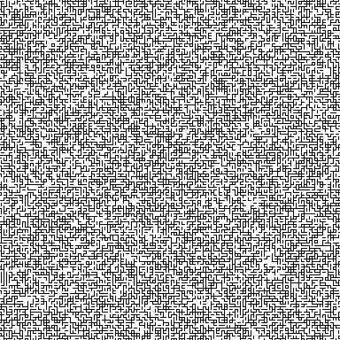

# Parallel Wave Function Collapse 

PWFC is a C++ implementation of the Wave Function Collapse (WFC) algorithm, designed to generate 2D tile-based maps.

<p align="center"></p>

# How the Parallelization Works

WFC is hard to parallelize because a single collapse can propagate constraints across the whole map. PWFC makes it tractable with three ideas (full design, complexity analysis and proofs in the [report](docs/report.pdf)):

- **Bounded propagation.** The `Maze16` tileset (16 tiles whose corners are always empty) is designed so that an update never travels more than one cell: $\Delta_{prop} = 1$, proved in Section 4 of the report. Every collapse can therefore only affect the chunks right around it.
- **Conflict-free mask sliding.** The map is split into nodes of 3x3 chunks, one per MPI process. Every node slides a 3x3-chunk mask over its own 9 chunks in the same fixed order, so the masks of two nodes never cover the same chunk at the same time: no locks and no runtime conflict resolution. When a mask reaches into a neighbor's chunks, the owner sends a copy, the node updates it and sends it back before the next step.
- **Local communication.** Each node only talks to its 8 neighbors (King's graph topology), through asynchronous halo exchanges and one synchronization per sliding step.

The parallel output is statistically equivalent to the sequential one (it comes from the same distribution of valid maps), but it is not identical for the same seed, because cells collapse in a different order.

# Results

Measured on CAPRI, the University of Padova HPC system (16 Intel Xeon Gold 6130 CPUs, 6 TB RAM), averaging 5 seeds per configuration:

| MPI processes | 1 | 4 | 16 | 64 |
|---|---|---|---|---|
| Time for an L = 6000 map (s) | 750 | 181 | 44.5 | 16.0 |
| Average relative speedup (L = 1000 to 6000) | 1 | 4.2 | 16.9 | 36.0 |

Scaling is super-linear up to 16 processes, which fit on one 16-core CPU and share its caches. Beyond that, processes span several CPUs and synchronization time grows; the report discusses this and a halo-caching improvement.

# Requirements
To build and run this project, your system must have the following:

- **C++ Compiler:** A compiler supporting C++17 (GNU, Clang, or MSVC).
- **CMake:** Version 3.12 or higher.
- **MPI Library:** Required for building the example executables (e.g., OpenMPI or MPICH).

# Building the Project

The project uses CMake to generate the executables. Run the following commands in the root of the repository:

```bash
mkdir build
cd build
cmake .. -DCMAKE_BUILD_TYPE=Release
cmake --build .
```

# Library Usage 

The PWFC library is designed around generating tile-based maps chunk-by-chunk using a predefined ruleset. Below is the standard workflow for setting up and generating a map within your own C++ projects.

## Define Your Rules and Ruleset

Before generation, you must tell the algorithm how your tiles are allowed to connect.

Create Rules: Build a `std::vector<PWFC::Rule>`. A single `Rule(AId, BId, A2B)` explicitly states that pattern `AId` can connect to pattern `BId` across direction `A2B`.

Set Weights: Create a `std::vector<float>` of weights corresponding to each pattern. This influences how often certain patterns appear during the random collapse.

Build the Ruleset: Combine these into a `PWFC::RuleSet` object, providing the rules, the weights, the total number of unique patterns (maxEntropy), and a random seed.

```C++
std::vector<PWFC::Rule> rules = { /* ... */ };
std::vector<float> weights = { /* ... */ };
int maxEntropy = /* Number of unique tiles */;
unsigned int seed = /* Your seed */;

PWFC::RuleSet ruleset(rules, weights, maxEntropy, seed);
```

## Initialize Your Chunks

The generator processes data in a 3x3 matrix of chunks, focusing on collapsing the central chunk while respecting the boundary states of any surrounding chunks.

Instantiate `PWFC::Chunk` objects with your desired side `length` and `maxEntropy`.

Place pointers to these chunks into a `std::array<PWFC::Chunk*, 9>`.

> **Important Note:** The chunk to be generated must be placed at index 4 (the center). Missing or empty neighbors should be passed as nullptr.

```C++
int chunkLength = /* set your parameter */;
PWFC::Chunk centralChunk(chunkLength, maxEntropy);

// Setup the 3x3 neighborhood (flattened)
std::array<PWFC::Chunk*, 9> chunks = {
    nullptr, nullptr, nullptr,
    nullptr, &centralChunk, nullptr,
    nullptr, nullptr, nullptr
};
```

## Generate the Map

With your ruleset and chunk array prepared, you can trigger the Wave Function Collapse algorithm.

Call `PWFC::Generate()` and evaluate the resulting `PWFC::ErrCode` to handle any logical contradictions the algorithm might have encountered.


```C++
PWFC::ErrCode status = PWFC::Generate(chunks, ruleset);

if (status != PWFC::ERR_OK) {
    // Handle specific errors: ERR_ZERO_ENTROPY, ERR_OUT_OF_CHUNK, or ERR_INVALID_INPUT
}
```

## Build and Validate

Once generation is successful, you can extract the raw integer map and validate it to ensure no rules were broken.

Build: Call Build() on your chunk. This returns a std::vector<int> where each element is the final state ID. Uncollapsed or errored cells will be assigned `PWFC::STATE_INVALID (-1)`.

Validate: Pass the built map to `PWFC::Validate()` for a final coherence check against your ruleset.


```C++
std::vector<int> finalMap = centralChunk.Build();

bool isValid = PWFC::Validate(finalMap, ruleset, chunkLength);
if (isValid) {
    // Map is mathematically coherent and ready for rendering!
}
```

# Sample Projects 

The above  will produce two sample executables in your build directory. Such programs generate a maze map using a 16 pattern tileset.

- *maze16-wfc:* The sequential generator.
- *maze16-mpi-wfc:* The MPI-based parallel generator.

Both executables share the same command-line interface for configuration.

**Command-Line Arguments:**
- **-l or --length:** The base length dimension of the map. Default is 128 for MPI and 16 for Sequential.
- **-o or --output:** The file path where the resulting PNG image will be saved.
- **-s or --seed:** The random seed used for the WFC generation.

## Running Sequentially

To generate a map using a single process:

```bash
./maze16-wfc -l 32 -s 12345 -o output_seq.png
```

## Running in Parallel

> **Important:** The MPI application must be run with a perfect squared number of processes (e.g., 1, 4, 9, 16).

```bash
mpirun -np 4 ./maze16-mpi-wfc -l 128 -s 98765 -o output_mpi.png
```

# Authors

Filippo Battisti, Simone Freschet and Francesco Bittasi, Parallel Computing course, University of Padova, A.Y. 2025/2026.
